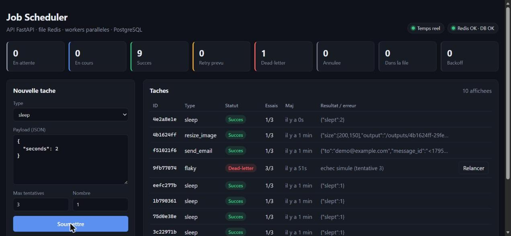

# Job Scheduler

Système distribué de traitement de tâches asynchrones — l'équivalent simplifié de Celery / Sidekiq / SQS + Lambda.
Une API reçoit des tâches, les place dans une file Redis, et un pool de workers les consomme en parallèle,
avec **retry automatique (backoff exponentiel)**, **dead-letter queue** et **suivi temps réel** via WebSocket.



```
Dashboard (React) ──HTTP──▶ API (FastAPI) ──RPUSH──▶ Redis jobs:queue ──BLPOP──▶ Workers (xN)
      ▲                         │                                                  │
      │                         └──────────── PostgreSQL (statuts + résultats) ◀───┤
      └──── WebSocket /ws/tasks ◀── Redis Pub/Sub jobs:events ◀────────────────────┘
                                         échec après N retries ──▶ jobs:dead (dead-letter)
```

## Démarrage

```bash
cp .env.example .env              # ajuster les ports si déjà utilisés
docker compose up --build --scale worker=3
```

| Service | URL |
|---|---|
| Dashboard | http://localhost:3000 |
| API + Swagger | http://localhost:8000/docs |
| Mailpit (emails envoyés par `send_email`) | http://localhost:8025 |

```bash
curl -X POST localhost:8000/tasks -H 'content-type: application/json' \
     -d '{"type": "flaky", "payload": {"failure_rate": 0.7}, "max_attempts": 4}'
# {"id": "…", "status": "pending"}   <- réponse immédiate, l'exécution est asynchrone
```

## Stack

| Composant | Techno |
|---|---|
| API | FastAPI, Pydantic v2, psycopg 3 (async, pool) |
| File | Redis : liste (`BLPOP`), sorted set pour les retries différés, Pub/Sub pour les événements |
| Workers | Python, scalables en conteneurs (`--scale worker=N`) ou en processus (`WORKER_PROCESSES=N`) |
| Base | PostgreSQL 16 (source de vérité des statuts) |
| Dashboard | React 18 + Vite, WebSocket avec reconnexion automatique, servi par nginx |
| Tests / CI | pytest (unitaires + intégration), ruff, eslint, GitHub Actions |

## API

| Méthode | Route | Description |
|---|---|---|
| POST | `/tasks` | Crée une tâche, la pousse dans Redis, renvoie son id immédiatement |
| GET | `/tasks/{id}` | Statut et résultat d'une tâche |
| GET | `/tasks?status=&limit=&offset=` | Liste filtrable et paginée |
| POST | `/tasks/{id}/retry` | Relance une tâche `dead_letter` (409 sinon) |
| DELETE | `/tasks/{id}` | Annule une tâche encore `pending` (409 sinon) |
| WS | `/ws/tasks` | Flux des changements de statut |
| GET | `/stats` | Compteurs par statut + profondeur des files |
| GET | `/health` | API, Redis, PostgreSQL (503 si dégradé) |

Types de tâches (payload validé par Pydantic, 422 si invalide) :

| Type | Payload | Rôle |
|---|---|---|
| `sleep` | `{seconds}` | démo |
| `flaky` | `{failure_rate, seconds}` | démo retry / dead-letter |
| `send_email` | `{to, subject, body}` | envoi SMTP (Mailpit en local) |
| `resize_image` | `{url, width, height}` | télécharge + redimensionne (Pillow), résultat servi sur `/outputs/` |

## Cycle de vie et garanties

```
pending ─▶ running ─▶ success
              │
              └─▶ failed ──(backoff 2s, 4s, 8s…)──▶ running ─▶ … ─▶ dead_letter
pending ─▶ cancelled
```

- **Pas de double exécution** : Redis ne livre un élément `BLPOP` qu'à un seul worker, et surtout le passage
  en `running` est un `UPDATE … WHERE status IN ('pending','failed')` atomique. Même si un id se retrouve deux fois
  dans la file, un seul worker le réclame (testé avec 2 workers et des doublons injectés volontairement).
- **Retries différés** : les échecs vont dans un sorted set `jobs:delayed` (score = date d'échéance) ; un script Lua
  atomique les remet dans la file quand ils arrivent à échéance — aucun worker ne dort pendant le backoff.
- **Erreurs permanentes** (type inconnu, payload invalide, HTTP 4xx, fichier non-image) : dead-letter directe, sans retry inutile.
- **Tolérance aux crashs** : un *reaper* périodique remet en file les tâches restées `running` trop longtemps
  (worker tué) et réconcilie les tâches `pending` absentes de Redis. Les écritures de fin sont conditionnées
  au numéro de tentative, donc un worker « zombie » ne peut pas écraser l'état d'une tentative plus récente.
- **Arrêt propre** : sur `SIGTERM`, le worker finit sa tâche en cours avant de s'arrêter.
- **Idempotence des handlers** : le fichier image est nommé d'après l'id de tâche, le `Message-ID` de l'email aussi.

Sémantique : *at-least-once* (comme SQS/Celery) — un handler peut être rejoué après un crash, d'où l'importance de l'idempotence.

## Structure

```
api/        main.py (routes + WebSocket), models.py (Pydantic), db.py (PostgreSQL async), queue.py (Redis)
worker/     worker.py (boucle BLPOP), retry.py (backoff, logique pure), store.py (PostgreSQL), tasks/ (handlers)
shared/     config, constantes, schéma SQL, payloads, sérialisation des événements
dashboard/  app React (Vite) + nginx
tests/      test_api.py, test_worker.py, test_integration.py, conftest.py
```

## Tests

```bash
# Unitaires (Redis et PostgreSQL mockés : fakeredis + dépôts en mémoire)
python -m venv .venv && .venv/Scripts/pip install -r requirements-dev.txt   # bin/ sous Linux/macOS
pytest tests/test_api.py tests/test_worker.py

# Tout, y compris l'intégration avec vrais Redis + PostgreSQL
docker compose --profile test run --rm --build tests
```

Intégration couverte : `pending → running → success` observé via Pub/Sub ; échec → 2 retries → `dead_letter` → relance manuelle ;
2 workers simultanés sans double traitement ; annulation ; reprise d'une tâche d'un worker crashé ; healthcheck.

La CI (`.github/workflows/ci.yml`) exécute à chaque push : ruff + eslint, tous les tests avec des services Redis/PostgreSQL
éphémères, puis le build des 3 images Docker.

## Déploiement

`docker compose up -d` sur un serveur suffit. Pour une démo publique (Railway / Render) : déployer `Dockerfile.api` et
`Dockerfile.worker` comme services, avec un Redis et un PostgreSQL managés (`DATABASE_URL`, `REDIS_URL`), et le dashboard
en statique en définissant `VITE_API_URL` (et `CORS_ORIGINS` côté API).

## Ce que j'ai appris

- **Concurrence** : la file distribue, mais c'est la base qui arbitre — un `UPDATE` conditionnel vaut mieux qu'un verrou applicatif.
- **Idempotence** : avec une livraison *at-least-once*, chaque handler doit supporter d'être rejoué.
- **Tolérance aux pannes** : distinguer erreurs transitoires (retry + backoff) et permanentes (dead-letter), et prévoir le crash d'un worker en plein traitement.
- **Observabilité** : chaque transition publie un événement, ce qui rend le dashboard temps réel sans polling.
